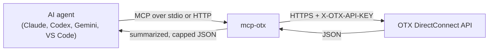

<p align="center">
  
</p>

<p align="center">
  <a href="https://pypi.org/project/otx-mcp/"></a>
  <a href="https://github.com/w0h1v/mcp-otx/actions/workflows/ci.yml"></a>
  <a href="LICENSE"></a>
  
  <a href="https://registry.modelcontextprotocol.io"></a>
</p>

<p align="center">
  <a href="#quickstart">Quickstart</a> ·
  <a href="#tools">Tools</a> ·
  <a href="#http-transport">HTTP</a> ·
  <a href="#security">Security</a> ·
  <a href="#troubleshooting">Troubleshooting</a> ·
  <a href="https://w0h1v.github.io/mcp-otx/">Docs</a>
</p>

**mcp-otx** is an [MCP](https://modelcontextprotocol.io) server that gives AI agents access to [AlienVault OTX](https://otx.alienvault.com) (Open Threat Exchange, now LevelBlue). Hand your agent an IP, domain, file hash, URL or CVE, or a malware family or adversary to research, and get back what the OTX community knows: pulses, reputation, passive DNS, whois, sandbox analysis and related indicators.

> [!NOTE]
> Independent project, not affiliated with AlienVault or LevelBlue. You need your own [OTX API key](https://otx.alienvault.com/settings/api); a free account is enough.

## Highlights

- **Full API coverage.** 29 tools across pulses, indicators, users, subscriptions and URL submissions, plus resource templates for pulses and indicators.
- **One-call indicator enrichment.** Every OTX indicator type (IPv4, IPv6, domain, hostname, file hash, URL, CVE) and detail section: reputation, geo, passive DNS, malware, whois, URL lists, HTTP scans, sandbox analysis.
- **Read-only by default.** The 9 tools that change your OTX account only appear with `--read-write`.
- **Context-sized output.** Large OTX objects are summarized and capped, with the API's total counts kept, so one lookup doesn't fill the model's context.
- **Safe HTTP.** stdio for desktop clients, plus streamable HTTP with bearer-token auth. The server refuses to listen on a network-facing address without a token.
- **Tested.** Unit tests against a mocked OTX API run in CI on Python 3.10 to 3.13.

## How it works



## Quickstart

**Requirements:** Python 3.10 or newer, [uv](https://docs.astral.sh/uv/) (or pip), and an OTX API key.

```sh
# Claude Code
claude mcp add --transport stdio --env OTX_API_KEY=your-key otx -- uvx otx-mcp

# Codex CLI
codex mcp add otx --env OTX_API_KEY=your-key -- uvx otx-mcp

# Gemini CLI
gemini mcp add -e OTX_API_KEY=your-key otx uvx otx-mcp
```

With pip: `pip install otx-mcp`, then use the command `otx-mcp`. For Claude Desktop, VS Code, Cline, Docker and running from source, see [Connect a client](docs/clients.md).

Then ask your agent: *"What does OTX know about 8.8.8.8, and are there recent pulses about Emotet?"* More prompts are in [example workflows](docs/examples.md).

## Tools

20 read tools, plus 9 write tools with `--read-write`. Full parameters and real sample output are in the [tool reference](docs/tools.md).

| Area | Read tools | Write tools (`--read-write`) |
|---|---|---|
| Search | `search_pulses`, `search_users` | |
| Pulses | `get_pulse_details`, `get_pulse_indicators`, `get_related_pulses`, `search_related_pulses`, `list_pulse_activity`, `list_subscribed_pulses`, `get_subscribed_pulse_ids`, `get_pulse_events` | `create_pulse`, `subscribe_pulse`, `unsubscribe_pulse` |
| Indicators | `get_indicator_details`, `validate_indicator`, `list_indicator_types`, `export_indicators` | |
| Users | `get_user`, `get_current_user`, `list_user_pulses`, `list_my_pulses` | `subscribe_user`, `unsubscribe_user`, `follow_user`, `unfollow_user` |
| Submissions | `list_submitted_urls`, `list_submitted_files` | `submit_url`, `submit_urls` |

Resource templates: `otx://pulse/{pulse_id}` and `otx://indicator/{type}/{value}`.

## HTTP transport

stdio is the default. For remote or web clients, run streamable HTTP:

```sh
OTX_API_KEY=your-key uvx otx-mcp --transport streamable-http
# → http://127.0.0.1:8000/mcp
```

To listen on a network-facing address, set a bearer token. Clients must then send `Authorization: Bearer <token>`:

```sh
OTX_API_KEY=your-key OTX_MCP_BEARER_TOKEN=a-long-random-secret \
  uvx otx-mcp --transport streamable-http --host 0.0.0.0
```

```sh
docker build -t mcp-otx .
docker run --rm -p 127.0.0.1:8000:8000 -e OTX_API_KEY=your-key \
  -e OTX_MCP_BEARER_TOKEN=a-long-random-secret \
  -e OTX_MCP_TRANSPORT=streamable-http -e OTX_MCP_HOST=0.0.0.0 mcp-otx
```

OTX is slow on some endpoints (passive DNS and subscriptions can take 20 to 60 s), so give remote clients a long read timeout (120 s works).

### Configuration

| Variable | CLI flag | Default | Description |
|---|---|---|---|
| `OTX_API_KEY` | | *(required)* | Your OTX API key. Also read from `.env` |
| `OTX_API_BASE` | | `https://otx.alienvault.com/api/v1` | API root (for testing) |
| `OTX_MCP_TRANSPORT` | `--transport` | `stdio` | `stdio`, `streamable-http` or `sse` |
| `OTX_MCP_HOST` | `--host` | `127.0.0.1` | HTTP bind address |
| `OTX_MCP_PORT` | `--port` | `8000` | HTTP port |
| `OTX_MCP_READ_WRITE` | `--read-write` | off | `1` exposes the account-changing tools |
| `OTX_MCP_BEARER_TOKEN` | | off | Require `Authorization: Bearer <token>` on HTTP |
| | `--allow-remote` | off | Allow a network-facing bind without a token (not recommended) |
| | `--json-response` | off | Plain JSON instead of SSE streams (streamable HTTP) |
| | `--stateless-http` | off | A new session per request (streamable HTTP) |

## Security

> [!WARNING]
> The server acts as your OTX account. Keep it read-only unless you need the write tools, and never expose HTTP without a bearer token and TLS.

- **Read-only by default.** Pulse creation, subscriptions, follows and URL submissions need `--read-write`. Editing or deleting pulses isn't exposed as a tool at all.
- **Untrusted content.** Pulse and indicator descriptions are written by the OTX community. The server tells the model to treat them as data, not instructions.
- **The API key** is sent only to the OTX API, in a header.

Details are in the [security model](docs/security.md). Report vulnerabilities privately; see [SECURITY.md](SECURITY.md).

## Troubleshooting

- **403 "Authentication required":** the API key is wrong. `get_current_user` shows which account a key belongs to.
- **A write tool is missing:** start the server with `--read-write`.
- **Timeouts:** passive DNS and subscription calls can take up to 60 s. Raise your client's tool timeout.

More in the [troubleshooting guide](docs/troubleshooting.md).

## Development

```sh
git clone https://github.com/w0h1v/mcp-otx && cd mcp-otx
uv venv && uv pip install -e ".[dev]"
.venv/bin/python -m pytest    # mocked OTX API, no key or network
```

See [CONTRIBUTING.md](CONTRIBUTING.md) and the [changelog](CHANGELOG.md).

## License

MIT. See [LICENSE](LICENSE).

<!-- mcp-name: io.github.w0h1v/otx -->
